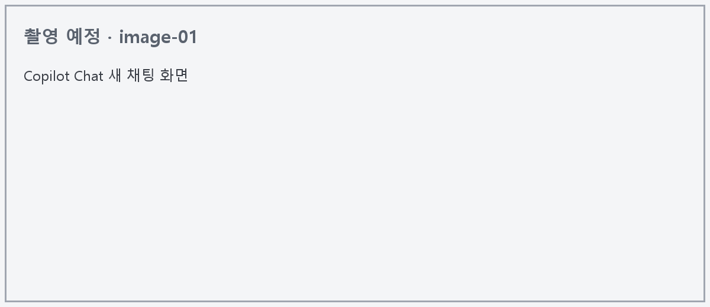
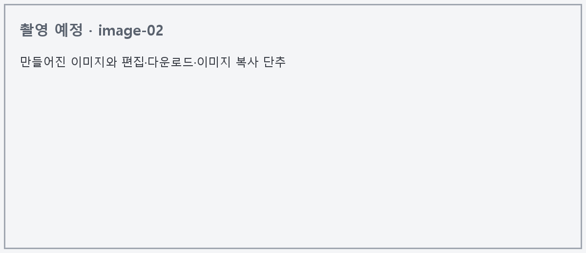
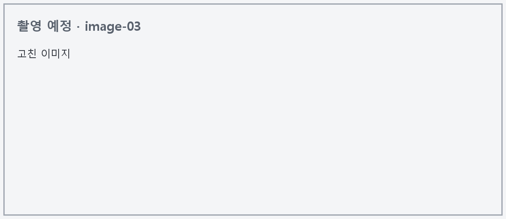
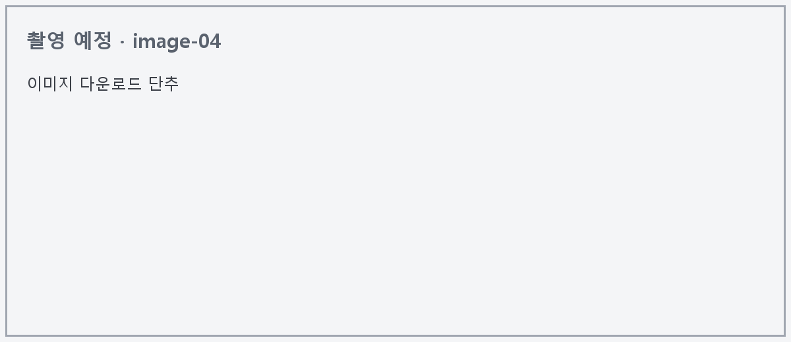
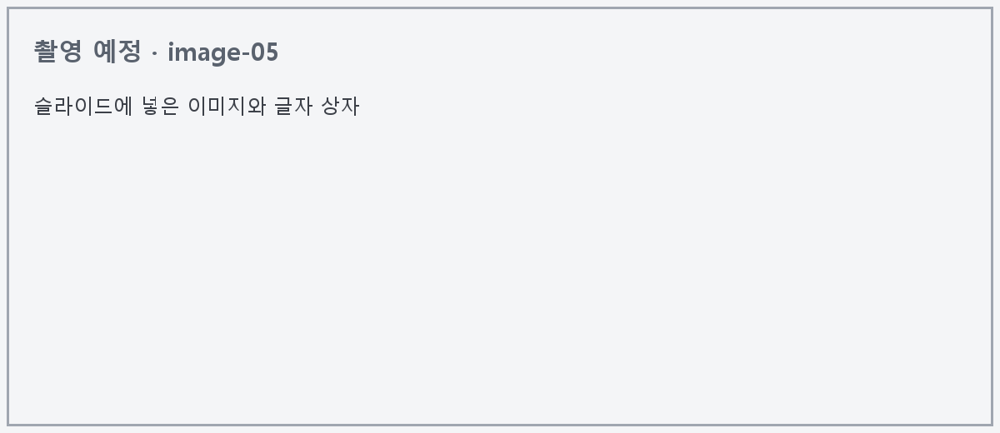

# Chat으로 이미지 만들기

> **할 일**: M365 Copilot Chat에서 업무용 이미지를 만들고, 고치고, 받아서 발표 자료에 넣습니다.
>
> **끝나면 남는 것**: 발표 자료에 넣은 이미지 1장

---

## 요청 문장 만들기

이미지 요청은 아래 여섯 가지를 차례로 적으면 결과가 원하는 쪽에 가까워집니다.

| 항목 | 예 |
|---|---|
| 용도 | 신제품 출시 안내 슬라이드의 표지 이미지 |
| 대상 | 제품 병 하나 |
| 분위기 | 밝은 톤, 깨끗한 배경 |
| 구도 | 가운데 배치, 위쪽에 여백 |
| 비율 | 가로형(16:9) 또는 정사각형 |
| 글자 | 넣지 않음 (글자는 PowerPoint에서 따로 넣음) |

---

## 단계

1. M365 Copilot Chat에서 **새 채팅**을 엽니다.

    

2. 아래 문장을 보냅니다.

    ```
    화장품 브랜드 신제품 출시 안내용 이미지를 만들어 주세요. 밝은 톤, 글자 없이, 제품 병 하나.
    ```

3. 1분 안팎에 이미지 1장이 만들어집니다. 이미지 위의 **편집**, **다운로드**, **이미지 복사** 단추를 확인합니다. 비율을 적지 않으면 세로형으로 나올 수 있습니다.

    

4. 같은 대화에 고칠 내용을 보냅니다. 처음부터 다시 요청하지 않고 바꿀 점만 적습니다.

    ```
    배경을 분홍색으로 바꾸고 정사각형으로 만들어 주세요.
    ```

    

5. 마음에 드는 이미지에서 **다운로드**를 누릅니다. PNG 파일이 다운로드 폴더에 저장됩니다.

    

6. PowerPoint에서 슬라이드를 열고 다운로드한 이미지를 넣습니다. 제목과 문구는 PowerPoint의 글자 상자로 넣습니다.

    

확인

- 같은 대화에서 고치면 앞의 이미지를 바탕으로 바뀝니다. 과정 준비 때 관측한 결과, 배경색과 비율만 바뀌고 병 모양은 유지됐습니다.
- 이미지 안에 한글 문구를 넣어 달라고 해도 정확하게 들어간 사례가 있었습니다. 다만 문구를 바꿀 일이 생기면 이미지를 다시 만들어야 하므로, 글자는 슬라이드의 글자 상자로 넣습니다.

---

## 쓸 때 지킬 것

| 항목 | 기준 |
|---|---|
| 실제 상표·로고 | 다른 회사의 상표나 로고를 그려 달라고 하지 않습니다. 과정 준비 때 다른 회사 로고를 요청했을 때 거절 없이 그려진 사례가 있었습니다. 막아 주지 않으므로 요청하는 쪽에서 지킵니다 |
| 실제 인물 | 실제 인물을 닮게 그려 달라고 하지 않습니다 |
| 사내 자료 | 공개 전 제품의 이름·디자인 같은 사내 정보는 요청 문장에 넣지 않습니다 |
| 사용 범위 | 사내 발표·초안용으로 씁니다. 외부 게시물·광고에 쓸 때는 회사의 생성 이미지 사용 기준을 따릅니다 |

---

## 확인

- [ ] 여섯 항목을 넣어 요청 문장을 썼다
- [ ] 같은 대화에서 이미지를 한 번 고쳤다
- [ ] 이미지를 다운로드해 슬라이드에 넣고, 글자는 글자 상자로 넣었다
