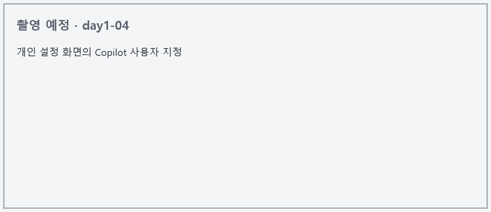
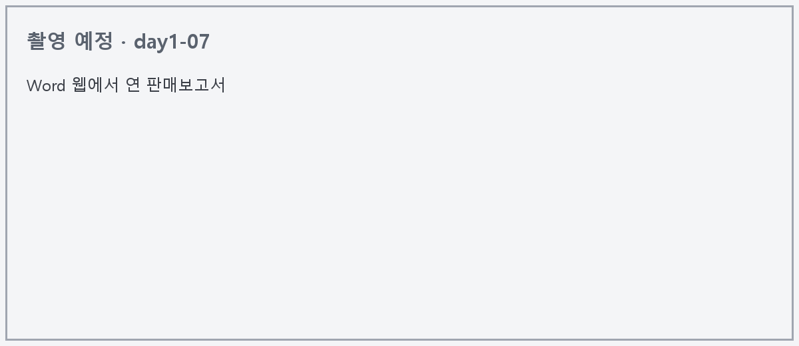
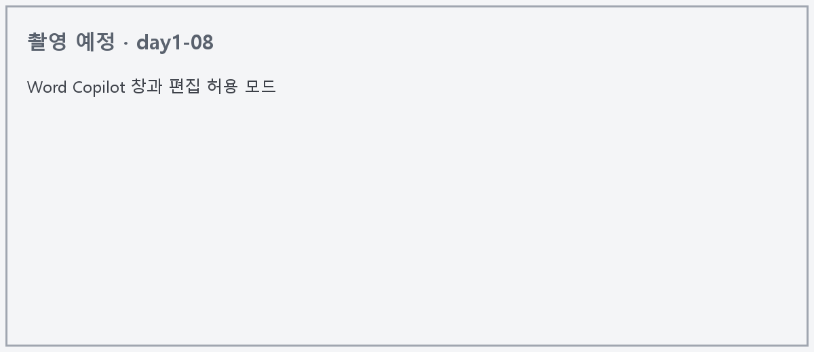
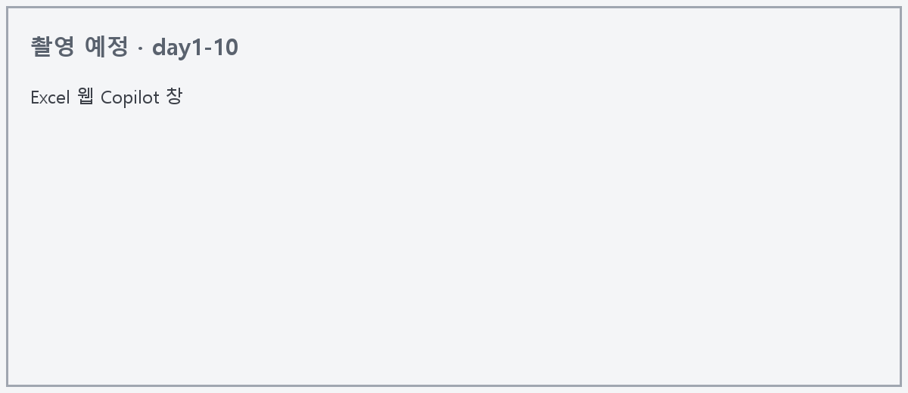
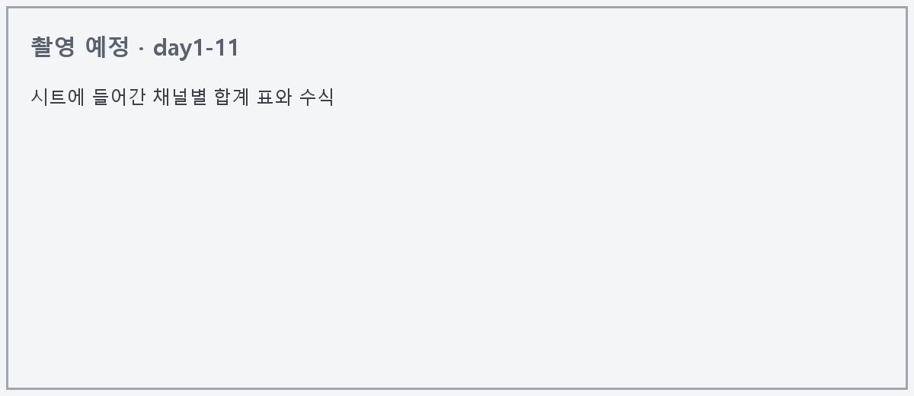
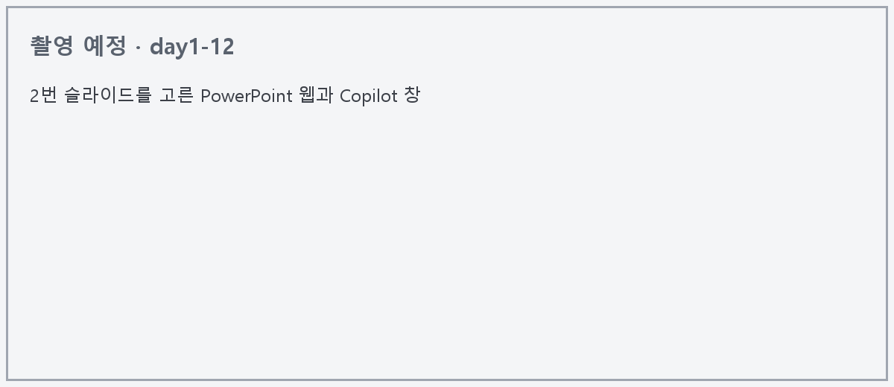
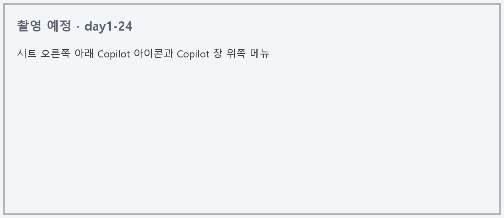
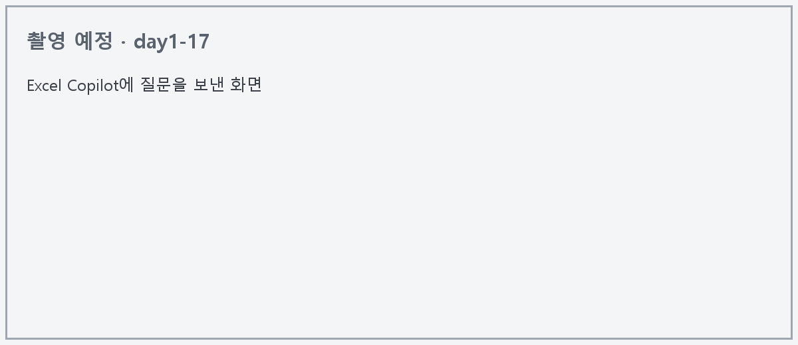
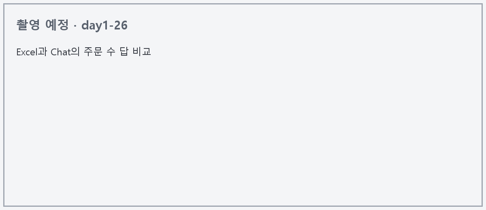

# D1. 이해와 선정

> **오늘 할 일**: 같은 Copilot이 앱과 실행 환경에 따라 어떻게 다르게 일하는지 직접 보고, 내 업무에 맞는 환경을 고릅니다.
>
> **오늘 끝나면 남는 것**: 내 Copilot 개인 설정, 업무 규칙을 넣어 다시 물은 대화, 내 업무 한 건의 환경 선정 메모

---

## 시간표

| 시간 | 절 | 방식 |
|---|---|---|
| 0:20 | 1절. 실행 환경이란 | 설명 |
| 0:20 | 2절. 나에게 맞게 설정하기 | 실습 |
| 0:50 | 3절. 앱마다 다른 Copilot | 실습 |
| 0:20 | 4절. Excel과 Chat에 같은 질문 보내기 | 실습 |
| 0:20 | 휴식 | |
| 0:50 | 5절. 답을 원본으로 확인하기 | 실습 |
| 0:40 | 6절. 다시 묻고 비교하기 | 실습 + 시연 |
| 0:20 | 7절. 내 업무에 맞는 환경 고르기 | 실습 |

4절에서 보낸 질문은 휴식 동안 계속 진행됩니다.

## 준비

- 회사 계정으로 M365 Copilot에 로그인합니다.
- 아래 표의 파일 이름을 눌러 다운로드한 뒤, 개인 OneDrive의 `심화교육_D1` 폴더에 저장합니다.

| 파일 | 쓰는 절 |
|---|---|
| [`화장품판매_50만행.xlsx`](../../assets/download/deep/화장품판매_50만행.xlsx) | 4·5·6절 |
| [`D1_판매보고서.docx`](../../assets/download/deep/D1_판매보고서.docx) | 3절 |
| [`D1_판매실적발표.pptx`](../../assets/download/deep/D1_판매실적발표.pptx) | 3절 |
| [`D1_채널별매출.xlsx`](../../assets/download/deep/D1_채널별매출.xlsx) | 3절 |

실습은 배포한 가상 데이터로만 합니다. 실제 업무 파일은 첨부하지 않습니다.

---

## 1절. 실행 환경이란 (0:20)

### 3일 구성

| 일차 | 주제 | 다루는 것 |
|---|---|---|
| D1 | 이해와 선정 | 앱과 실행 환경에 따른 차이 |
| D2 | 확장과 자산화 | 코드 실행 공간, 스킬, 에이전트로 일하는 방식을 재사용 |
| D3 | 위임과 통제 | AI·시스템·사람 사이에 업무를 나누기 |

### Copilot의 답을 정하는 것

Copilot의 답은 모델 하나로 정해지지 않습니다. 모델을 감싼 실행 환경이 같이 정합니다. 이 과정에서는 이 실행 환경을 「하네스」라고 부릅니다.

| 실행 환경 | 예 |
|---|---|
| 작업 대상 | 지금 열린 문서, 첨부한 파일, OneDrive·SharePoint의 파일 |
| 빌트인 스킬 | 앱마다 들어 있는 작업 능력 |
| 코드 실행 공간 | 파일을 열어 계산하는 공간. Excel·PowerPoint에는 있고 Word에는 없습니다 |
| 개인 설정 | 내 모든 대화에 걸리는 지침과 메모리 |

같은 질문이라도 이 네 가지가 다르면 처리 방식과 결과가 달라질 수 있습니다. 오늘은 그 차이를 하나씩 확인합니다.

### 범위와 비용

- 오늘 실습은 M365 Copilot 라이선스 범위 안의 기능만 씁니다.
- 라이선스·환경·크레딧 기준은 기초교육 Part 04를 따릅니다.

---

## 2절. 나에게 맞게 설정하기 (0:20)

같은 질문을 개인 설정 전후로 보내고 답이 어떻게 바뀌는지 봅니다.

1. M365 Copilot Chat에서 **새 채팅**을 엽니다.

    

2. 아래 문장을 보냅니다.

    ```
    Copilot Studio 에이전트 흐름은 어떤 경우에 크레딧을 사용하나요?
    ```

3. 답 아래 출처에 Microsoft Learn 문서가 있는지 확인합니다.

    

4. 같은 대화에 아래 문장을 보내 설명 방식을 바꿔 봅니다. 스킬을 부르는 것이 아니라 이 대화에서 한 번만 요청하는 문장입니다. 이런 설명 방식을 ELI5(Explain Like I'm 5)라고 부릅니다.

    ```
    방금 내용을 다섯 살 아이에게 설명하듯 쉬운 말로 다시 설명해 주세요.
    ```

    

5. 오른쪽 위 **설정** → **개인 설정**을 엽니다. **Copilot 사용자 지정**이 보입니다.

    

6. 사용자 지정 지침 칸에 아래 한 줄을 입력하고 저장합니다.

    ```
    Microsoft 제품 질문은 Microsoft Learn 문서를 근거로 답하고 출처를 붙인다.
    ```

    

7. **새 채팅**을 열고 2번 문장을 다시 보냅니다. 출처가 3번 답과 어떻게 다른지 확인합니다.

    

8. 지침을 그대로 둘지 지울지 정합니다. 지우려면 5번 화면에서 지침 칸을 비우고 저장합니다.

확인

- 개인 설정의 지침은 내 모든 대화에 걸립니다. 그래서 항상 필요한 원칙만 넣습니다.
- 4번 같은 설명 방식을 지침에 넣으면 모든 답이 그 형식으로 바뀌고 길어집니다. 필요할 때만 쓰는 방식은 D2에서 스킬로 만들어 필요할 때 부릅니다.
- 과정 준비 때 개인 설정을 켠 계정과 끈 계정으로 같은 계산 문제를 정답과 대조해 검증했습니다. 정답 수는 같았습니다. 계산의 정확도는 5절에서 다른 방법으로 검증합니다.

---

## 3절. 앱마다 다른 Copilot (0:50)

Word·Excel·PowerPoint의 Copilot에 각 앱의 일을 시키고, 결과가 어디에 생기는지 봅니다. 마지막에 같은 일을 Chat에 시켜 비교합니다.

| 앱 | 작업 대상 | 코드 실행 공간 |
|---|---|---|
| Word | 열린 문서와 텍스트 | 없음 |
| Excel | 열린 통합 문서, 데이터, 수식 | 있음 |
| PowerPoint | 열린 프레젠테이션 | 있음 |
| M365 Copilot Chat | 대화, 첨부 파일 | 있음 |

1. OneDrive에서 `D1_판매보고서.docx`를 Word 웹으로 엽니다.

    

2. 리본 오른쪽 끝 **Copilot** 아이콘을 눌러 Copilot 창을 엽니다. 입력란 위 모드가 **편집 허용**인지 확인합니다.

    

3. 아래 문장을 보냅니다.

    ```
    이 문서를 임원 보고용 1쪽 요약으로 다시 써 주세요.
    ```

4. 문서 본문이 바로 바뀌고, 바뀐 곳이 강조되는지 확인합니다. 문서 아래 막대의 **완료**와 **실행 취소**를 봅니다.

    

5. `D1_채널별매출.xlsx`를 Excel 웹으로 엽니다. 시트 오른쪽 아래 **Copilot** 아이콘을 눌러 Copilot 창을 열고, 입력란 위 모드를 **편집 허용**으로 고릅니다.

    

6. 아래 문장을 입력하고 보내기 단추(↑)를 누릅니다. Excel에서는 Enter 키를 누르면 보내지지 않고 셀이 옮겨 갑니다.

    ```
    채널별 매출 합계를 새 열이나 새 표로 정리해 주세요.
    ```

7. 시트에 새 표가 바로 들어가는지 확인합니다. 표의 셀을 하나 눌러 수식이 들어 있는지 봅니다.

    

8. `D1_판매실적발표.pptx`를 PowerPoint 웹으로 엽니다. 왼쪽 목록에서 2번 슬라이드를 누른 뒤, 리본 오른쪽 끝 **Copilot** 아이콘으로 Copilot 창을 엽니다.

    

9. 아래 문장을 보냅니다.

    ```
    2번 슬라이드의 내용을 표 한 장으로 다시 구성해 주세요.
    ```

10. 2번 슬라이드가 표로 바뀌는지 확인합니다. 「문제가 발생하여 요청을 완료할 수 없습니다」가 나오면 창 위 **새 채팅**(⊕)을 누르고 2번 슬라이드를 다시 고른 뒤 보냅니다.

    

11. 세 앱 각각의 Copilot 창에서 입력란 **+** → **플러그 인 선택** → **플러그 인** 탭을 엽니다. 앱마다 보이는 항목을 비교합니다.

    

12. Chat에서 **새 채팅**을 열고, `+` → **클라우드 파일 첨부**로 `D1_판매실적발표.pptx`를 첨부해 9번과 같은 요청을 보냅니다. 결과가 새 파일로 오는지 확인합니다.

    

확인

- 앱의 Copilot은 지금 열린 문서를 직접 고칩니다. Word와 Excel은 **실행 취소**로 되돌릴 수 있는 막대를 보여 줍니다.
- Chat은 원본을 그대로 두고 새 파일을 만듭니다. 새 파일은 OneDrive의 `Copilot` 폴더에 저장됩니다.
- 앱마다 플러그 인 목록이 다릅니다. Excel에는 다른 앱에 없는 **기술 기록**이 있습니다.
- 결과의 숫자는 원본과 대조합니다. 과정 준비 때 관측한 결과, Excel은 「계산 결과 값은 확인하지 않았습니다」라고 답했고, PowerPoint는 원본에 없던 합계 줄을 덧붙였습니다.

---

## 4절. Excel과 Chat에 같은 질문 보내기 (0:20)

같은 파일과 같은 질문을 Excel의 Copilot과 Chat에 보냅니다. 두 대화 모두 새로 엽니다. 답은 휴식 뒤 5절에서 확인합니다.

1. OneDrive에서 `화장품판매_50만행.xlsx`를 Excel 웹으로 엽니다. 시트가 9개 있습니다.

    

2. 오른쪽 위 **편집 중**을 눌러 **보는 중**으로 바꿉니다. 실습 중에 파일이 바뀌지 않습니다.

3. 시트 오른쪽 아래 **Copilot** 아이콘을 눌러 Copilot 창을 엽니다. 창 위쪽 **새 채팅**(⊕)을 눌러 새 대화로 시작합니다.

    

4. 입력란 위 모드를 **채팅만**으로 고릅니다.

    

5. 아래 문장을 보냅니다.

    ```
    이 파일로 답해 주세요.
    1. 매출액 합계는 얼마인가요?
    2. 주문은 몇 건인가요?
    3. 제품라인별 매출액 상위 3개와 금액은?
    4. 판매상세 시트로 계산한 캠페인ID 1번의 매출액 합계는 얼마인가요?
    ```

    

6. Chat에서 **새 채팅**을 엽니다.

7. `+` → **클라우드 파일 첨부**로 `화장품판매_50만행.xlsx`를 고릅니다. 업로드 표시가 끝날 때까지 기다립니다.

    

8. 5번과 같은 문장을 보냅니다.

9. 두 답 중 어느 쪽이 먼저 끝나는지 봅니다. 휴식 시간이 되면 끝나지 않았어도 휴식합니다.

## 휴식 (0:20)

---

## 5절. 답을 원본으로 확인하기 (0:50)

현업 파일에는 정답표가 없습니다. 원본 안에 이미 있는 규칙과 값으로 답을 확인합니다.

### 원본의 규칙 찾기

1. Excel 웹에서 「설명」 시트를 엽니다.

    

2. 「판매상세」 행의 설명을 읽습니다. 매출을 셀 때 빼는 행이 적혀 있습니다.

    > 반품여부가 Y인 행은 매출 집계에서 뺀다.

3. 4절의 두 답에 「반품」이라는 말이 있는지 찾습니다. 이 말은 규칙을 적용했다는 단서입니다. 실제로 적용했는지는 아래에서 「캠페인」 시트 값과 대조해 판정합니다.

### 원본 안의 다른 값과 대조

1. 「캠페인」 시트를 엽니다. 캠페인ID 1번 행의 「귀속매출(원)」 값을 찾습니다.

    

2. 「설명」 시트의 「캠페인」 행을 읽습니다. 귀속 매출은 반품여부 N인 행만 더한 값입니다.

3. 4절 답의 질문 4 값과 「귀속매출(원)」 값을 나란히 놓고 비교합니다.

4. 값이 다르면 같은 대화에 아래 문장을 보냅니다.

    ```
    질문 4를 계산할 때 어떤 행을 더했는지 계산 기준을 보여 주세요.
    ```

5. 답에서 반품 행을 넣었는지 뺐는지 확인합니다.

    

### 규칙을 알려 주고 다시 묻기

1. Chat에서 **새 채팅**을 열고 같은 파일을 첨부합니다.

2. 아래 문장을 보냅니다.

    ```
    이 파일로 답해 주세요. 아래 규칙을 따르세요.
    - 매출은 판매상세 시트에서 반품여부가 N인 행만 더한다.
    - 주문 수는 주문ID의 고유 개수다.
    - 제품라인은 판매상세의 제품ID로 제품 시트에서 찾는다.

    1. 매출액 합계는 얼마인가요?
    2. 주문은 몇 건인가요?
    3. 제품라인별 매출액 상위 3개와 금액은?
    4. 판매상세 시트로 계산한 캠페인ID 1번의 매출액 합계는 얼마인가요?
    ```

3. 질문 4 값이 「캠페인」 시트의 귀속매출과 같은지 확인합니다.

    

4. Excel의 Copilot 창에서도 새 대화를 열고 같은 문장을 보냅니다.

5. 두 답의 질문 2(주문 수)를 비교합니다.

    

6. 두 값이 다르면 각 대화에 아래 문장을 보냅니다.

    ```
    주문 수를 셀 때 반품 행을 뺐나요, 포함했나요?
    ```

7. 답에서 각 값이 어떤 기준으로 센 것인지 확인합니다. 이 과정에서는 반품을 포함한 주문 수를 기준으로 합니다. 기준값은 강사가 알려 줍니다.

8. 기준을 질문에 붙여 다시 묻습니다.

    ```
    반품을 포함한 주문 수는 몇 건인가요?
    ```

확인

- 과정 준비 때 관측한 결과, Excel의 Copilot은 규칙을 주지 않아도 「설명」 시트의 반품 규칙을 적용했습니다(4회). Chat은 적용하지 않았습니다(3회). 같은 파일과 같은 질문이라도 실행 환경에 따라 결과가 달랐습니다.
- 규칙을 준 뒤 Chat은 4문항 모두 업무 기준과 같았습니다. Excel은 반품 규칙을 주문 수에도 적용해 반품을 뺀 주문 수를 답했습니다(2회).
- 주문 수는 반품을 포함해도, 빼도 맞는 값일 수 있습니다. 질문에 기준이 없으면 어느 기준으로 셌는지 되물어 확인합니다. 규칙을 매번 붙여 넣는 일은 D2에서 스킬과 에이전트로 정해 둡니다.

---

## 6절. 다시 묻고 비교하기 (0:40)

### 같은 질문 한 번 더

5절에서 정한 주문 수 기준을 넣어 문장을 확정합니다. 다시 물을 때는 이 문장만 씁니다.

1. Chat에서 **새 채팅**을 열고 같은 파일을 첨부한 뒤, 아래 문장을 보냅니다.

    ```
    이 파일로 답해 주세요. 아래 규칙을 따르세요.
    - 매출은 판매상세 시트에서 반품여부가 N인 행만 더한다.
    - 주문 수는 반품여부와 관계없이 주문ID의 고유 개수다.
    - 제품라인은 판매상세의 제품ID로 제품 시트에서 찾는다.

    1. 매출액 합계는 얼마인가요?
    2. 주문은 몇 건인가요?
    3. 제품라인별 매출액 상위 3개와 금액은?
    4. 판매상세 시트로 계산한 캠페인ID 1번의 매출액 합계는 얼마인가요?
    ```

2. Excel의 Copilot 창에서도 새 대화를 열고 같은 문장을 보냅니다.

3. 두 환경의 네 값이 5절에서 확인한 값과 같은지 봅니다. 주문 수는 강사가 알려 준 기준값과 비교합니다.

### 강사 시연: 파일을 이름으로만 부를 때

강사 화면에서 진행합니다. 수강생은 따라 하지 않습니다.

1. Chat에서 **새 채팅**을 엽니다. 파일은 첨부하지 않습니다.

2. 아래 문장을 보냅니다. 위 문장의 첫 줄 「이 파일로」만 파일 위치로 바꿨습니다.

    ```
    OneDrive의 심화교육_D1 폴더에 있는 화장품판매_50만행.xlsx 파일로 답해 주세요. 아래 규칙을 따르세요.
    - 매출은 판매상세 시트에서 반품여부가 N인 행만 더한다.
    - 주문 수는 반품여부와 관계없이 주문ID의 고유 개수다.
    - 제품라인은 판매상세의 제품ID로 제품 시트에서 찾는다.

    1. 매출액 합계는 얼마인가요?
    2. 주문은 몇 건인가요?
    3. 제품라인별 매출액 상위 3개와 금액은?
    4. 판매상세 시트로 계산한 캠페인ID 1번의 매출액 합계는 얼마인가요?
    ```

3. 답이 나오기 전에 검색 단계가 표시되는지, 걸리는 시간, 답의 출처 카드에 나온 파일 위치를 봅니다.

    

### 오늘 본 것

| 구분 | 확인한 것 |
|---|---|
| 정확도 | 계산의 정확도와 업무 기준의 정확도는 다를 수 있습니다. 업무 규칙을 준 뒤 원본 값과 대조해 검증합니다 |
| 응답 시간 | 과정 준비 때 측정한 결과, Excel의 Copilot은 30초 안팎에 답했습니다. Chat은 첨부한 파일로 1~3분 안팎이 많았고, 10분 넘게 걸린 회차도 있었습니다. 파일 이름으로만 부르면 검색을 거쳐 5~8분이 걸렸습니다 |
| 재현성 | 규칙을 명시하고 같은 질문을 새 대화에서 다시 물어, 같은 결과가 재현되는지 봅니다 |
| 파일 위치 | 파일 이름으로만 부르면 이름이 같은 다른 파일을 읽을 수 있습니다. 출처 카드의 폴더와 수정 시각을 확인합니다 |

---

## 7절. 내 업무에 맞는 환경 고르기 (0:20)

| 업무 요구사항 | 먼저 검토할 환경 |
|---|---|
| 지금 연 문서의 작성·분석·편집 | Office 앱의 Copilot |
| 일회성 분석, 여러 파일을 대상으로 한 작업 | M365 Copilot Chat |
| 같은 방식과 형식으로 반복하는 작업 | Chat + 스킬 (D2) |
| 다른 사람도 같은 지침으로 써야 하는 작업, 지식 범위를 좁혀야 하는 작업 | Agent Builder (D2) |
| 사람의 승인이 들어가는 정해진 절차 | Power Automate (D3) |
| AI 판단과 시스템 실행을 묶는 작업 | Copilot Studio + 에이전트 흐름 (D3) |

위에서부터 차례로 봅니다. 아래 칸이 더 나은 환경이라는 뜻은 아닙니다. 요구사항을 채우는 가장 단순한 환경을 고릅니다.

1. Chat에서 **새 채팅**을 열고 아래 틀에 내 업무를 채워 보냅니다. 위 표가 문장 안에 들어 있습니다.

    ```
    아래 내 업무를 정리하고, 아래 선택표 기준으로 먼저 검토할 환경을 하나 골라 이유를 두 줄로 적어 주세요. 표는 위에서부터 차례로 보고, 요구사항을 채우는 가장 단순한 환경을 고릅니다.

    [내 업무]
    - 업무:
    - 쓰는 파일:
    - Copilot이 모르는 업무 규칙:
    - 반복 여부(한 번 / 매주 / 매일):
    - 같은 방식으로 쓰는 사람(나만 / 팀):
    - 사람의 승인이 필요한 단계(없음 / 있음):

    [선택표]
    | 업무 요구사항 | 먼저 검토할 환경 |
    |---|---|
    | 지금 연 문서의 작성·분석·편집 | Office 앱의 Copilot |
    | 일회성 분석, 여러 파일을 대상으로 한 작업 | M365 Copilot Chat |
    | 같은 방식과 형식으로 반복하는 작업 | Chat + 스킬 |
    | 다른 사람도 같은 지침으로 써야 하는 작업, 지식 범위를 좁혀야 하는 작업 | Agent Builder |
    | 사람의 승인이 들어가는 정해진 절차 | Power Automate |
    | AI 판단과 시스템 실행을 묶는 작업 | Copilot Studio + 에이전트 흐름 |
    ```

2. 답이 고른 환경이 내 판단과 같은지 확인합니다.

3. 답을 대화에 남겨 둡니다. D2와 D3에서 같은 업무를 이어서 봅니다.

---

## 확인

- [ ] 개인 설정 전후로 같은 질문의 출처를 비교했다
- [ ] Word·Excel·PowerPoint에서 결과가 열린 문서 안에 생기고, Chat은 새 파일을 만드는 것을 확인했다
- [ ] 「설명」 시트 규칙과 「캠페인」 시트 값으로 답을 확인했다
- [ ] 규칙을 준 뒤 질문 4 값이 「캠페인」 시트 값과 같은지 확인했다
- [ ] 내 업무 한 건의 환경을 골랐다
