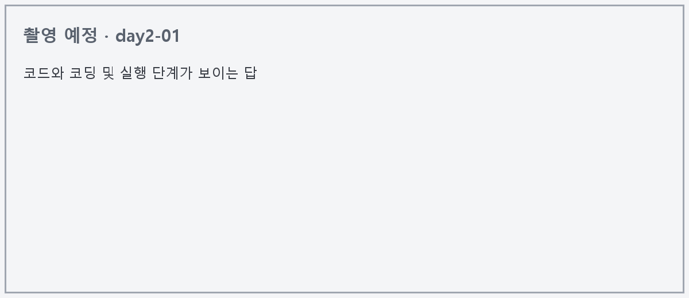
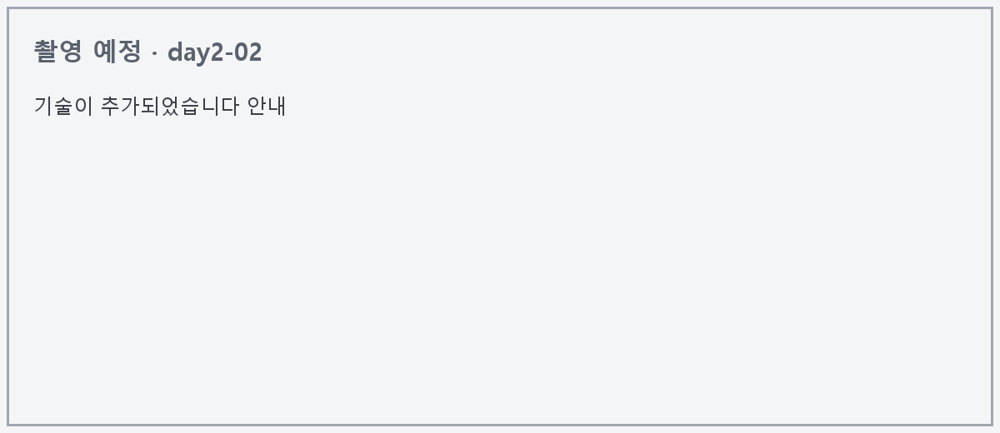
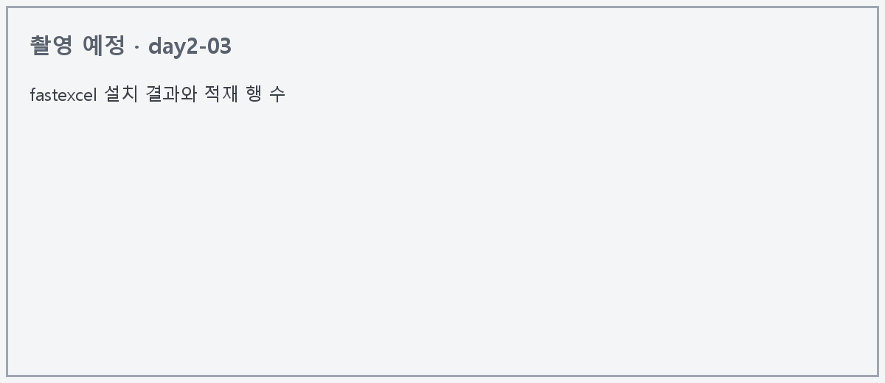
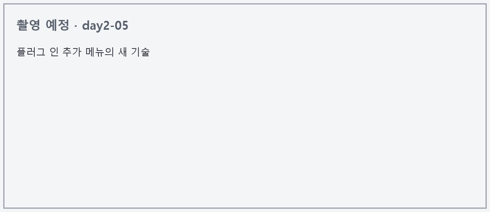
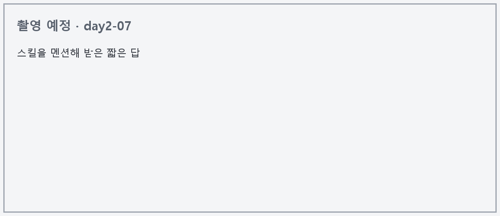
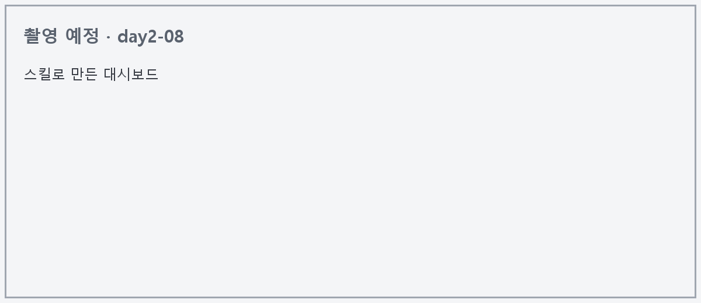
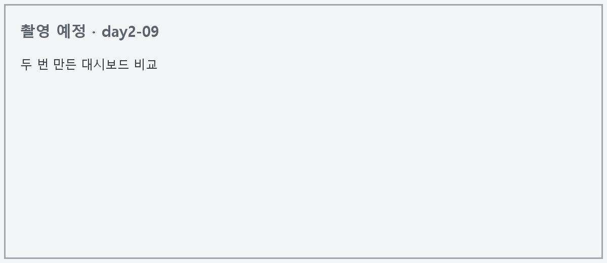
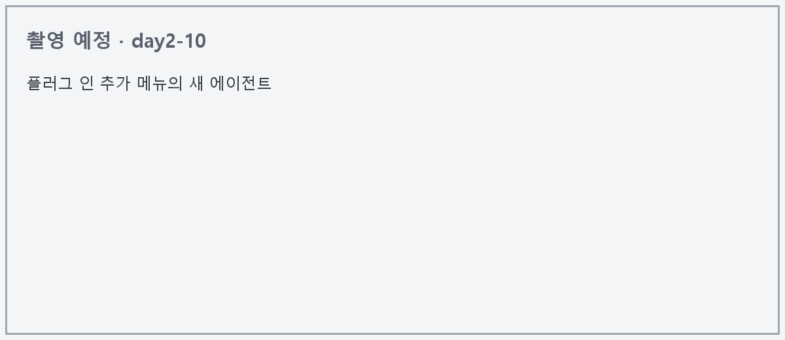
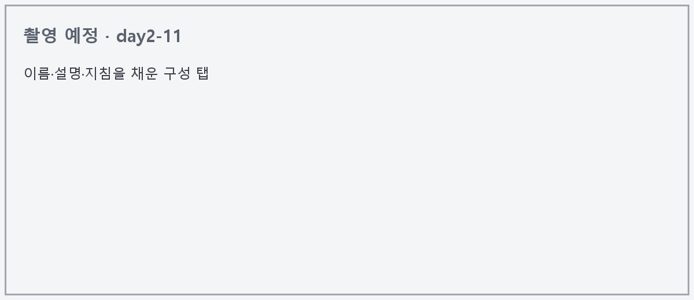
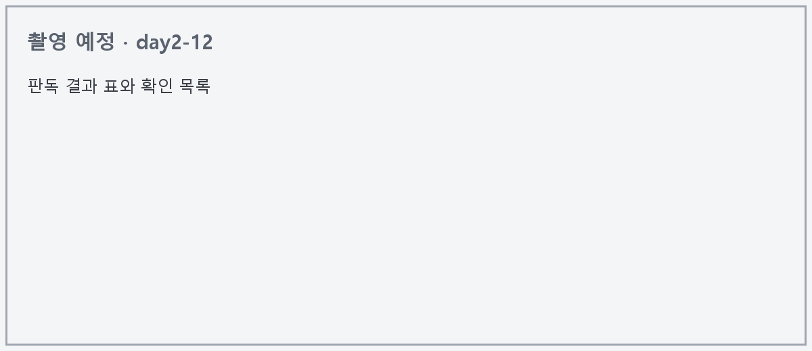

# D2. 확장과 자산화

> **오늘 할 일**: 코드 실행 공간에서 처리 방식을 명시하고, 업무 규칙과 형식을 스킬로 정해 두고, Agent Builder로 업무 전용 에이전트를 만듭니다.
>
> **오늘 끝나면 남는 것**: 내가 만든 스킬 1개, 등록한 대시보드 스킬, OCR 리딩 에이전트 1개

---

## 시간표

| 시간 | 절 | 방식 |
|---|---|---|
| 0:20 | 1절. 코드 실행 공간 | 설명 + 실습 |
| 0:50 | 2절. 처리 방식을 명시하기 | 실습 |
| 0:40 | 3절. 스킬 만들기 | 실습 |
| 0:20 | 휴식 | |
| 0:15 | 4절. 스킬로 같은 형식 만들기 | 실습 |
| 0:15 | 5절. 다시 실행해 비교하기 | 실습 |
| 1:20 | 6절. OCR 리딩 에이전트 | 실습 |

## 준비

배포한 실습 파일을 개인 OneDrive의 `심화교육_D2` 폴더에 저장합니다.

| 파일 | 쓰는 절 |
|---|---|
| `화장품판매_50만행.xlsx` | 1·2절 |
| `excel-fastexcel-load.zip` | 2절 |
| `cosmetic-sales-dashboard.zip` | 3·4·5절 |
| `판매실적_01.csv` | 4·5절 |
| `D2_전표_깨끗.pdf`, `D2_전표_흐림.pdf` | 6절 |
| `D2_OCR지침.txt` | 6절 |

실습은 배포한 가상 데이터로만 합니다.

---

## 1절. 코드 실행 공간 (0:20)

Copilot은 첨부한 파일을 코드 실행 공간(Sandbox)에서 열어 계산합니다. D1에서 Excel과 Chat이 답을 계산한 곳이 이 공간입니다.

| 코드 실행 공간의 성질 | 결과 |
|---|---|
| 대화마다 따로 있고, 시간이 지나면 정리한 표가 남지 않음 | 새 대화에서는 원본부터 다시 읽음 |
| 그 대화를 연 사람만 봄 | 정리한 결과를 남기고 나누려면 OneDrive에 저장 |
| 인터넷과 사내 시스템에 연결되지 않음 | 계산할 파일은 첨부로 넣음 |
| 코드는 답을 얻는 수단 | 남길 것은 코드가 아니라 검증한 처리 방법 |

1. M365 Copilot Chat에서 **새 채팅**을 열고 `화장품판매_50만행.xlsx`를 `+` → **클라우드 파일 첨부**로 첨부합니다.

2. 아래 문장을 보냅니다.

    ```
    이 파일을 코드로 열어 시트 이름과 각 시트의 행 수만 알려 주세요. 실행한 코드도 보여 주세요.
    ```

3. 답에 코드가 붙어 있는지, 추론을 펼치면 「코딩 및 실행」 단계가 있는지 확인합니다.

    

---

## 2절. 처리 방식을 명시하기 (0:50)

D1에서는 Copilot이 처리 방식을 스스로 골랐습니다. 이 절에서는 처리 방식을 정해 주고 결과를 원본과 대조합니다.

| 도구 | 하는 일 |
|---|---|
| fastexcel | 엑셀 파일을 빠르게 읽음 |
| Polars | 읽은 표를 정리하고 집계함 |
| SQLite | 정리한 표를 담아 두고 질문마다 계산식으로 조회함 |
| 코드베이스 | 검증한 처리 방법을 스킬 안에 남겨 다시 씀 |

코드를 직접 쓰지 않습니다. 어떤 처리 방식을 쓸지 고르고, 결과를 검증하는 데 집중합니다.

### 스킬 등록

1. Chat에서 **플러그 인** → **추가** → **업로드**를 누르고 `excel-fastexcel-load.zip`을 고릅니다.

2. 「기술이 추가되었습니다」 안내를 확인합니다.

    

### 처리 방식을 정해 묻기

1. **새 채팅**을 열고 `화장품판매_50만행.xlsx`를 첨부합니다.

2. 입력란에 `@excel-fastexcel-load`를 입력해 스킬을 멘션한 뒤, 아래 문장을 이어서 보냅니다.

    ```
    판매상세 시트를 SQLite 테이블로 적재한 뒤 SQL로 답하세요. 적재한 행 수를 먼저 알려 주세요.
    - 매출은 반품여부가 N인 행만 더한다.
    - 주문 수는 반품여부와 관계없이 주문ID의 고유 개수다.
    1. 매출액 합계는 얼마인가요?
    2. 주문은 몇 건인가요?
    ```

3. 답 첫 줄의 「fastexcel 설치」 결과와 적재한 행 수를 확인합니다.

    

4. 첫 답이 끝날 때까지 걸린 시간을 봅니다.

### 같은 대화에서 이어 묻기

1. 같은 대화에 아래 문장을 보냅니다. 파일은 다시 첨부하지 않습니다.

    ```
    브랜드별 매출액 합계를 큰 순서로 보여 주세요.
    ```

2. 이번 답이 끝날 때까지 걸린 시간을 첫 답과 비교합니다.

### 정합성 검증

1. 같은 대화에 아래 문장을 보냅니다.

    ```
    적재한 테이블의 전체 행 수, 반품여부가 Y인 행 수, 캠페인ID 1번의 반품 제외 매출액을 SQL로 구해 주세요.
    ```

2. 전체 행 수를 「설명」 시트에 적힌 판매상세 행 수와 비교합니다.

3. 캠페인ID 1번 값을 「캠페인」 시트의 귀속매출과 비교합니다.

    

확인

- 첫 답에는 fastexcel 설치와 적재 시간이 들어 있습니다. 같은 대화에서 이어 묻는 질문은 이미 적재한 테이블을 씁니다. 두 질문은 내용이 달라서, 걸린 시간의 차이를 모두 적재 시간으로 보지는 않습니다.
- 행 수와 원본 안의 다른 값으로 결과를 검증합니다.

---

## 3절. 스킬 만들기 (0:40)

D1에서 설명 방식을 지침에 넣지 않았습니다. 지침은 모든 대화에 걸리기 때문입니다. 필요할 때만 쓰는 방식은 스킬로 만듭니다.

| 구분 | 걸리는 범위 | 부르는 방법 |
|---|---|---|
| 개인 설정 지침 | 내 모든 대화 | 부르지 않아도 걸림 |
| 스킬 | 부른 대화 | 입력란에서 `@스킬이름` |

### ELI5 스킬 만들기

1. Chat에서 **플러그 인** → **추가** → **새 기술**을 누릅니다. 입력란에 스킬을 만드는 요청 문장이 채워지면 그대로 보냅니다.

    

2. 같은 대화에 아래 문장을 보냅니다.

    ```
    M365 Copilot에 업로드할 스킬을 만들어 주세요.
    - 스킬 이름: eli5-explainer
    - 하는 일: 사용자가 고른 내용을 다섯 살 아이에게 설명하듯 쉬운 말과 일상 비유로 다시 설명한다. 문장은 짧게, 5줄 이내로 쓴다. 전문 용어는 처음 한 번만 괄호로 남긴다.
    ```

3. 답에 나온 스킬 카드에서 **기술 저장**을 누릅니다.

    

4. 1분쯤 기다린 뒤 **새 채팅**을 엽니다. 입력란에 `@eli5`를 입력해 `eli5-explainer`를 멘션하고 아래 문장을 보냅니다.

    ```
    Copilot Studio 에이전트 흐름이 크레딧을 쓰는 경우를 설명해 줘.
    ```

    

5. **새 채팅**을 열고 스킬을 멘션하지 않은 채 같은 문장을 보냅니다. 4번 답과 길이·설명 방식을 비교합니다.

### 대시보드 스킬 등록

1. **플러그 인** → **추가** → **업로드**로 `cosmetic-sales-dashboard.zip`을 등록합니다.

2. 「기술이 추가되었습니다」 안내를 확인합니다.

확인

- 스킬은 멘션한 대화에서만 적용됩니다.
- 같은 이름으로 두 번 등록하면 목록에 같은 이름이 두 개 생기고 구분되지 않습니다. 한 가지 방법으로 한 번만 등록합니다.

## 휴식 (0:20)

---

## 4절. 스킬로 같은 형식 만들기 (0:15)

대시보드 스킬에는 템플릿·로고·스크립트가 들어 있습니다. 스킬을 멘션하면 Copilot이 대시보드를 직접 쓰지 않고 스크립트를 실행해 같은 형식으로 만듭니다.

1. **새 채팅**을 열고 `판매실적_01.csv`를 첨부합니다.

2. 입력란에 `@cosmetic-sales-dashboard`를 멘션하고 아래 문장을 보냅니다.

    ```
    첨부한 판매 실적으로 대시보드를 만들어 주세요.
    ```

3. 답의 다운로드 링크로 HTML 파일을 받아 엽니다. 로고, 색, 표·차트 배치를 확인합니다.

    

---

## 5절. 다시 실행해 비교하기 (0:15)

1. **새 채팅**을 열고 4절을 그대로 한 번 더 합니다.

2. 두 대시보드를 나란히 열고 형식과 숫자가 같은지 비교합니다.

    

확인

- 형식과 처리 방법을 스킬에 정해 두면 다시 실행해도 같은 결과가 재현되는지 확인할 수 있습니다.
- 과정 준비 때 같은 스킬을 세 번 실행한 결과, 세 파일이 모두 같았습니다.

---

## 6절. OCR 리딩 에이전트 (1:20)

전표 이미지를 읽어 정해진 항목을 표로 정리하는 에이전트를 Agent Builder로 만듭니다. 같은 지침으로 여러 사람이 써야 하는 일은 에이전트로 만듭니다.

### 에이전트 만들기

1. Chat에서 **플러그 인** → **추가** → **새 에이전트**를 누릅니다.

    

2. **구성** 탭에서 이름에 `전표 판독 도우미`, 설명에 `첨부한 전표에서 정해진 항목을 읽어 표로 정리한다`를 입력합니다. 설명을 비우면 만들어지지 않습니다.

3. `D2_OCR지침.txt`의 내용을 **지침** 칸에 붙여 넣습니다.

    

4. 회사 콘텐츠와 웹 검색을 끕니다. 이 에이전트는 첨부한 전표만 읽습니다.

5. **만들기**를 누릅니다.

### 판독하고 원본과 대조하기

1. 에이전트 대화에서 `D2_전표_깨끗.pdf`를 첨부하고 아래 문장을 보냅니다.

    ```
    첨부한 전표를 양식대로 읽어 주세요.
    ```

2. 표의 값을 전표 원본과 하나씩 대조합니다. 거래처명에 「귀중」이 붙은 받는 회사가, 담당자에 대표 이름이 들어가지 않았는지도 봅니다.

    

3. 에이전트의 새 대화를 열고 `D2_전표_흐림.pdf`를 첨부해 같은 문장을 보냅니다.

4. 메모에 두 가지를 적습니다. `[확인필요]`가 붙은 칸, 그리고 붙지 않았는데 원본과 다른 칸입니다.

5. 새 대화를 열고 파일을 첨부하지 않은 채 같은 문장을 보냅니다. 지침대로 「판독할 전표를 첨부해 주세요.」라고만 답하는지 확인합니다. 앞서 전표를 첨부한 대화에서 시험하면 그 전표를 다시 읽을 수 있어 새 대화에서 합니다.

### 지침을 고쳐 다시 판독하기

1. **구성** 탭의 지침 끝에 아래 한 줄을 더하고 저장합니다.

    ```
    - 거래처명과 금액은 글자 하나씩 다시 대조한 뒤 적는다. 하나라도 확실하지 않으면 [확인필요]를 붙인다.
    ```

2. 새 대화를 열고 `D2_전표_흐림.pdf`를 첨부해 같은 문장을 보냅니다. 앞 대화의 답이 섞이지 않도록 고치기 전과 같은 파일·같은 문장으로 새 대화에서 판독합니다.

3. 4번 메모의 칸이 어떻게 바뀌었는지 비교합니다. 흐린 전표는 같은 지침으로 다시 판독해도 결과가 바뀔 수 있습니다. 한 번의 결과로 지침의 효과를 단정하지 않습니다.

### 지식과 그라운딩

에이전트에 지식(문서·사이트)을 넣으면 Copilot은 질문과 가까운 자료를 찾아 답에 붙입니다. 이 단계를 그라운딩이라고 합니다. 그라운딩의 목적은 관련 자료를 빠르게 찾는 것이고, 정답을 보증하는 것이 아닙니다. 업로드한 문서는 검색할 수 있게 처리(인덱싱)되기까지 시간이 걸립니다.

| 근거 | 에이전트가 하는 일 | 확인할 것 |
|---|---|---|
| 첨부한 파일 | 파일을 직접 읽음 | 원본과 값 대조 |
| 지식에 넣은 문서 | 질문과 가까운 부분을 찾아 씀 | 답의 출처가 맞는 문서인지 |
| 근거가 없음 | 지침에 따라 답하지 않거나 첨부를 요청함 | 지어낸 값이 없는지 |

확인

- 지침은 판독 항목·표시 규칙·출력 형식을 정합니다. 에이전트를 쓰는 사람마다 같은 항목과 형식을 요청하게 됩니다. 실제 출력이 같은지는 다시 실행해 확인합니다.
- 흐린 전표에서는 확신하고 틀리는 칸이 있을 수 있습니다. 판독 결과는 원본과 대조합니다.
- 에이전트를 다른 사람과 쓰려면 공유합니다. 이 과정에서는 공유하지 않습니다.

---

## 확인

- [ ] 처리 방식을 정해 묻고, 결과를 행 수와 원본 값으로 검증했다
- [ ] ELI5 스킬을 만들고, 멘션했을 때와 하지 않았을 때를 비교했다
- [ ] 대시보드 스킬로 두 번 만든 결과가 같은지 비교했다
- [ ] OCR 리딩 에이전트를 만들고, 판독 결과를 원본과 대조했다
- [ ] 지침을 고친 뒤 판독 결과가 어떻게 바뀌는지 봤다
