# D3. 위임과 통제

> **오늘 할 일**: 업무를 단계로 나누고, AI가 판단할 일·시스템이 실행할 일·사람이 정할 일을 나눠 맡깁니다.
>
> **오늘 끝나면 남는 것**: 요청 List 1개, List에 요청을 등록하는 에이전트 1개, 사람이 승인하는 승인 흐름 1개

---

## 시간표

| 시간 | 절 | 방식 |
|---|---|---|
| 0:15 | 1절. 업무 나누기 | 실습 |
| 0:45 | 2절. SharePoint와 List 설계 | 설명 + 실습 |
| 0:30 | 3절. List 만들기 | 실습 |
| 0:20 | 4절. 표준 에이전트 만들기 | 실습 |
| 0:20 | 휴식 | |
| 0:50 | 5절. 에이전트 흐름으로 List에 등록하기 | 실습 |
| 0:40 | 6절. 승인 흐름 만들기 | 실습 |
| 0:20 | 7절. 내 업무의 구조 고르기 | 실습 |

## 준비

아래 표의 파일 이름을 눌러 PC에 다운로드합니다. List를 만들 때 PC에서 파일을 올립니다. OneDrive에 있는 파일은 고를 수 없습니다.

| 파일 | 쓰는 절 |
|---|---|
| [`D3_판매이슈요청.xlsx`](../../assets/download/deep/D3_판매이슈요청.xlsx) | 3절 |

실습은 배포한 가상 데이터로만 합니다.

같은 사이트와 환경을 여러 사람이 같이 씁니다. 오늘 만드는 List·에이전트·흐름 이름 끝에는 회차 번호와 영문 이니셜을 붙입니다.

| 만드는 것 | 이름 예(1회차, 이니셜 HGD) |
|---|---|
| List | `판매이슈요청_1회차_HGD` |
| 에이전트 | `판매이슈 접수 도우미_1회차_HGD` |
| 에이전트 스키마 이름 | `IssueIntake1HGD` |
| 에이전트 흐름 | `요청 등록_1회차_HGD` |
| 승인 흐름 | `승인_1회차_HGD` |

본문의 `HGD`는 내 이니셜로 바꿔 넣습니다. 같은 회차에 이니셜이 같은 사람이 있으면 뒤에 숫자를 붙입니다(예: `HGD2`).

---

## 1절. 업무 나누기 (0:15)

| 단계 | 질문 | 맡길 곳 |
|---|---|---|
| 입력 | 무엇을 받는가 | 사람 · 시스템 |
| 처리 | 정해진 규칙으로 계산·기록하는가 | 시스템(흐름) |
| 판단 | 뜻을 읽고 고르는가 | AI(에이전트) |
| 검증 | 결과가 맞는지 누가 보는가 | 사람 |
| 출력 | 어디에 남기는가 | 시스템(List·메일) |
| 예외 | 실패하거나 애매하면 어떻게 하는가 | 사람 |

정해진 규칙대로 매번 같게 해야 하는 일은 흐름에 맡깁니다. 문장을 읽고 뜻을 골라야 하는 일은 에이전트에 맡깁니다. 책임이 따르는 결정은 사람이 합니다.

1. D1 7절에서 업무를 정리한 Chat 대화로 돌아갑니다.

2. 아래 문장을 보냅니다.

    ```
    이 업무를 입력·처리·판단·검증·출력·예외로 나누고, 각 단계를 AI·시스템·사람 중 어디에 맡길지 표로 정리해 주세요.
    ```

3. 표에서 「사람」으로 정한 단계가 내 판단과 같은지 확인합니다.

---

## 2절. SharePoint와 List 설계 (0:45)

SharePoint List는 열마다 형식을 정해 두고 행 단위로 쌓는 표입니다. 여러 사람이 같은 표를 쓰고, 흐름이 행을 만들거나 바꿀 수 있습니다.

| List를 쓰는 일 | List를 쓰지 않는 일 |
|---|---|
| 요청·상태를 한 줄씩 쌓고 바꾸는 일(접수 → 승인) | 수만 행을 집계하는 일. 이런 일은 D2의 코드 실행 공간에서 함 |
| 흐름의 트리거와 알림 | 에이전트의 지식으로 넣어 건수·합계를 묻는 일 |

### 열 형식

| 열 형식 | 쓰는 곳 | 오늘 List의 열 |
|---|---|---|
| 한 줄 텍스트 | 제목·짧은 설명 | 제목 |
| 선택 | 정해진 값 중 하나 | 브랜드, 채널, 상태 |
| 사람 | 요청자·담당자 | 요청자(오늘은 한 줄 텍스트로 만듦) |
| 날짜 | 요청일·처리일 | 요청일 |
| 숫자 | 금액·수량 | 금액 |
| 조회 | 다른 List의 값을 가져옴 | (오늘은 쓰지 않음) |

오늘 List는 Excel 파일에서 만듭니다. 이 방법으로는 「사람」 형식을 고를 수 없어 요청자를 한 줄 텍스트로 둡니다(3절). 5절 흐름은 요청자·요청일을 채우지 않습니다. 흐름이 만든 행은 List의 「만든 사람」·「만든 날짜」로 언제 누가 등록했는지 봅니다. 「만든 사람」에는 흐름 연결에 쓴 계정이 남습니다. 오늘은 내 계정이라 요청자와 같지만, 다른 사람이 에이전트로 등록해도 같은 계정으로 남습니다.

### Master와 History

| 구분 | 담는 것 | 예 |
|---|---|---|
| Master | 지금 상태 한 줄 | 요청 하나의 현재 상태 |
| History | 바뀐 기록을 계속 쌓음 | 요청의 상태가 바뀔 때마다 한 줄 |

오늘은 Master 하나만 만듭니다.

1. 메모에 오늘 만들 List의 열을 위 표대로 적습니다.

2. 「상태」 열의 선택 값을 정합니다: `접수`, `승인`, `반려`

---

## 3절. List 만들기 (0:30)

1. SharePoint 실습 사이트에서 **사이트 콘텐츠** → **+ 새로 만들기** → **목록**을 누릅니다. 「어떻게 시작하시겠습니까?」 창이 열립니다.

    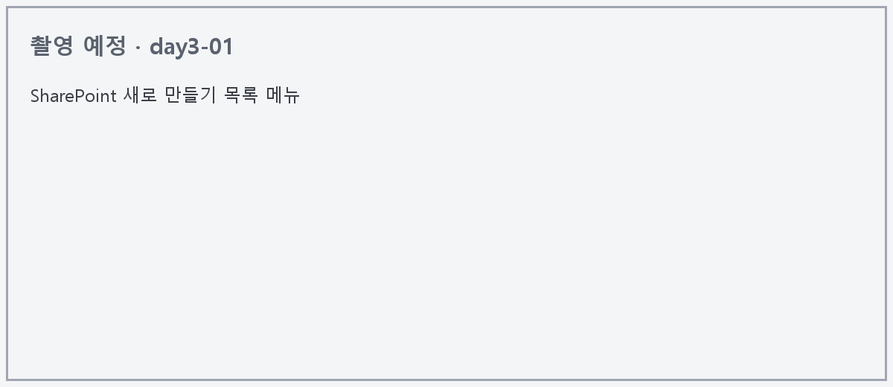

2. **Excel에서** → **파일 업로드**를 누르고 PC에 저장한 `D3_판매이슈요청.xlsx`를 고릅니다.

    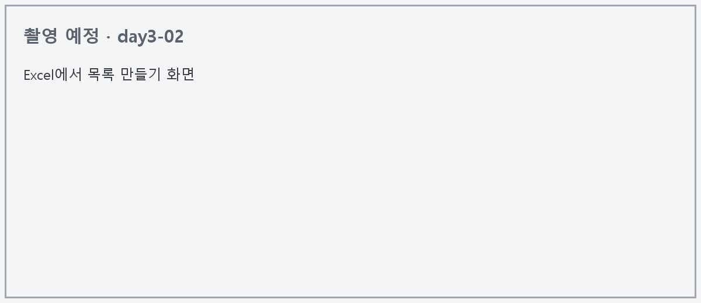

3. 열마다 형식을 확인합니다. 브랜드·채널·상태는 **선택 항목**, 요청일은 **날짜 및 시간**, 금액은 **숫자**로 바꿉니다. 요청자는 **한 줄 텍스트**로 둡니다. 이 화면에서는 「사람」 형식을 고를 수 없습니다.

    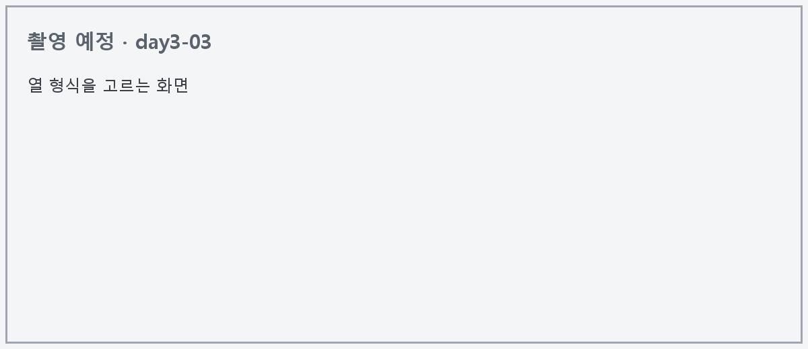

4. 이름 칸의 파일 이름을 `판매이슈요청_1회차_HGD`로 바꾸고 **만들기**를 누릅니다.

5. 만들어진 List의 행 수가 엑셀과 같은지 확인합니다.

    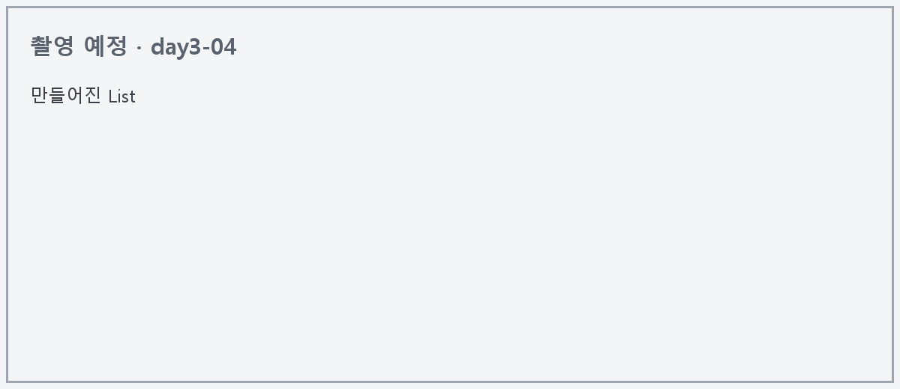

6. **+ 신규**로 행 하나를 직접 추가합니다. 상태는 `접수`로 둡니다.

---

## 4절. 표준 에이전트 만들기 (0:20)

기초교육에서 Copilot Studio 에이전트를 만든 방법과 같습니다.

1. Copilot Studio에서 실습 환경을 확인하고 홈의 **다른 빌드 방법** → **Build with standard orchestration** → **에이전트 · 표준**을 누릅니다. 카드에 「추가 크레딧 비용 없이 Microsoft 365 Copilot 라이선스에 포함되어 있습니다」가 적힌 쪽을 고릅니다.

    

2. 이름을 `판매이슈 접수 도우미_1회차_HGD`로 넣고, **에이전트 설정(선택 사항)**을 펼쳐 스키마 이름에 영문 `IssueIntake1HGD`를 넣은 뒤 만듭니다. 한글 이름만 넣으면 만들어지지 않습니다. 만든 뒤 개요 화면 **지침** 카드의 **편집**을 눌러 아래 내용을 넣고 저장합니다.

    ```
    너는 판매 이슈 요청을 받아 등록하는 도우미다.
    사용자가 이슈를 말하면 제목·브랜드·채널·금액을 확인하고, 빠진 값은 한 번에 하나씩 묻는다.
    값이 모두 모이면 요청 등록 도구로 등록하고, 등록된 요청 ID를 알려 준다.
    승인 여부는 판단하지 않는다. 승인은 담당자가 한다.
    ```

    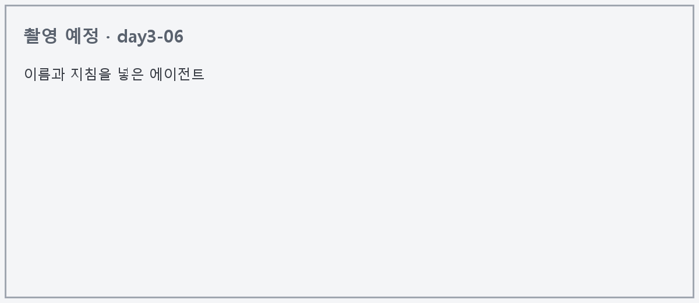

3. 테스트 채팅에서 「판매 이슈를 등록하고 싶어요」를 보내 빠진 값을 묻는지 확인합니다.

## 휴식 (0:20)

---

## 5절. 에이전트 흐름으로 List에 등록하기 (0:50)

에이전트가 모은 값을 받아, 흐름이 정해진 대로 List에 한 줄을 만듭니다.

| 항목 | 내용 |
|---|---|
| 트리거 | **에이전트가 흐름을 호출할 때** |
| 입력 | 제목, 브랜드, 채널, 금액 |
| 동작 | SharePoint **항목 만들기** |
| 출력 | 만들어진 항목의 ID |

이 트리거로 실행되는 흐름은 M365 Copilot 라이선스 사용자가 에이전트를 부를 때 라이선스 범위에 포함됩니다. 사람이 부르지 않아도 트리거가 에이전트를 실행하는 방식은 크레딧이 청구되어 이 과정에서 다루지 않습니다.

1. 에이전트의 **도구** → **도구 추가**를 누르고, **새로 만들기** 줄의 **에이전트 흐름**을 누릅니다.

    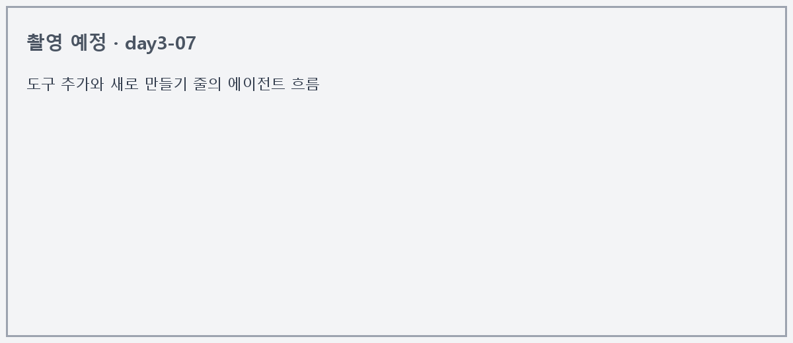

2. 트리거 카드의 **입력 추가**로 입력 네 개를 넣습니다. 제목·브랜드·채널은 **텍스트**, 금액은 **숫자**입니다. 각 입력의 설명 칸에는 기본값 「입력을 입력해 주세요」 대신 무엇을 넣는 값인지 적습니다.

    | 입력 | 설명 칸 |
    |---|---|
    | 제목 | 판매 이슈 제목 |
    | 브랜드 | 브랜드 이름만. 루미엘, 솔브룸, 블루포레, 그린밸런스, 오로라픽, 퓨어시드 중 하나 |
    | 채널 | 판매 채널 이름만. 자사몰, 면세점, 백화점·로드숍, 오픈마켓·플랫폼, 라이브커머스 중 하나 |
    | 금액 | 원 단위 숫자 |

    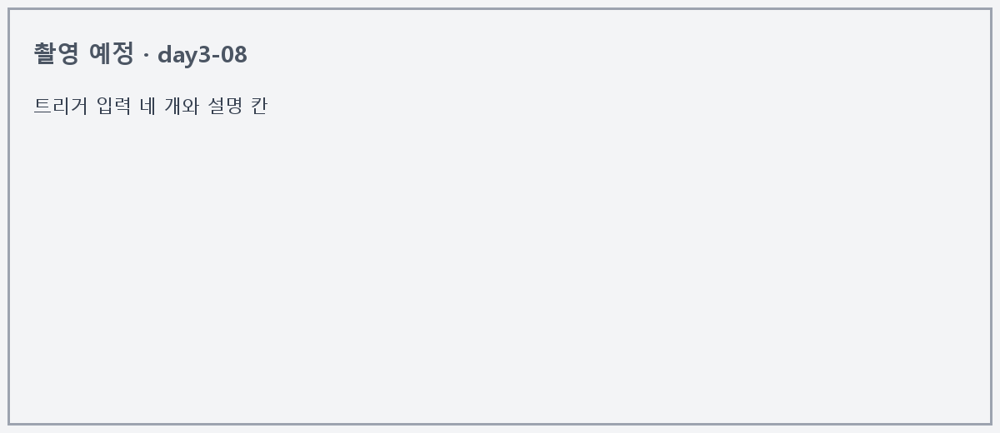

3. 트리거 아래 **+**에서 SharePoint **항목 만들기**를 추가하고 사이트와 `판매이슈요청_1회차_HGD` List를 고릅니다. **고급 매개 변수**의 **모두 보기**를 눌러 열을 펼칩니다.

4. 열마다 값을 넣습니다. 입력란에서 `/`를 누르고 **동적 콘텐츠 삽입**을 고르면 트리거 입력이 나옵니다.

    | 열 | 넣는 값 |
    |---|---|
    | Title | 트리거 입력 「제목」 |
    | 금액 | 트리거 입력 「금액」 |
    | 브랜드 Value · 채널 Value | 드롭다운에서 **사용자 지정 값 입력**을 고른 뒤 트리거 입력 「브랜드」·「채널」 |
    | 상태 Value | `접수` |

    제목 열은 화면에 「Title」로 나옵니다.

    

5. **Respond to the agent** 카드의 **출력 추가** → **숫자**를 고르고, 이름은 `요청ID`, 값은 항목 만들기의 **ID**로 넣습니다.

6. 왼쪽 위 흐름 이름(「제목 없음」)을 눌러 `요청 등록_1회차_HGD`로 바꾸고 **초안 저장**을 누른 뒤 **게시**합니다. 게시하지 않은 흐름은 에이전트가 부르지 못합니다.

7. 에이전트로 돌아가 **도구** → **도구 추가** → **흐름**에서 `요청 등록_1회차_HGD`를 고르고 **추가 및 구성**을 누릅니다. 도구 설명의 기본값은 흐름 이름입니다. 설명을 「판매 이슈 요청을 List에 등록한다」로 바꾸고 저장합니다.

    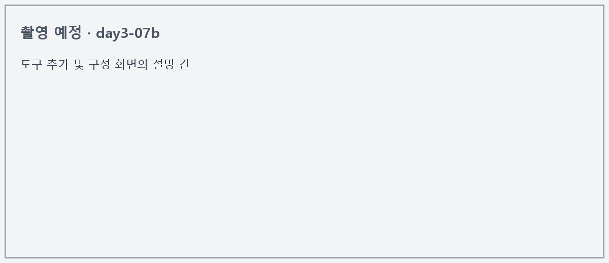

8. 테스트 창의 **새 테스트 세션 시작**을 누르고 아래 문장을 보냅니다.

    ```
    루미엘 세럼 판매 가격 오류 건 등록해 줘. 금액은 1,200,000원이야.
    ```

9. 에이전트가 빠진 값(채널)을 묻고, 등록한 뒤 요청 ID를 알려 주는지 확인합니다.

10. List를 새로 고쳐 새 행이 생겼는지, 제목·브랜드 칸에 값이 바르게 들어갔는지 확인합니다. 채팅 답에 값이 맞게 적혀 있어도 List에는 칸이 바뀌어 저장될 수 있습니다.

    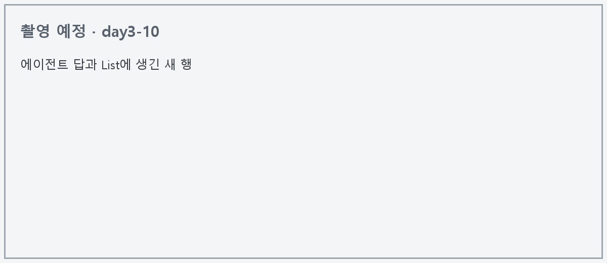

확인

- 에이전트는 값을 모으고, 흐름은 정해진 열에 정해진 형식으로 기록합니다.
- 에이전트는 도구의 이름과 설명을 보고 언제 흐름을 부를지 정합니다. 흐름 입력의 설명은 어느 값을 어느 입력에 넣을지 정하는 근거입니다.
- 브랜드·채널 열은 목록에 없는 값도 직접 입력한 값으로 받습니다. 입력 설명에 허용값을 적어 두지 않으면 같은 브랜드가 다른 이름으로 저장될 수 있습니다.
- 결과는 채팅 답이 아니라 List에서 확인합니다.

---

## 6절. 승인 흐름 만들기 (0:40)

5절에서 List에 생긴 행을 트리거로, 담당자가 승인하거나 반려하는 흐름을 만듭니다. 이 흐름은 Power Automate 클라우드 흐름으로 만듭니다.

| 항목 | 내용 |
|---|---|
| 만드는 곳 | Power Automate (Copilot Studio 에이전트 흐름이 아님) |
| 트리거 | SharePoint **항목이 만들어진 경우** |
| 동작 | **승인 시작 및 대기**, 결과에 따라 **항목 업데이트** |
| 넣지 않는 것 | AI 단계(프롬프트 실행 등), 에이전트 호출, 프리미엄 커넥터 |

1. Power Automate에서 **만들기** → **자동화된 클라우드 흐름**을 누릅니다. 같은 대화상자에서 흐름 이름을 `승인_1회차_HGD`로 넣습니다.

    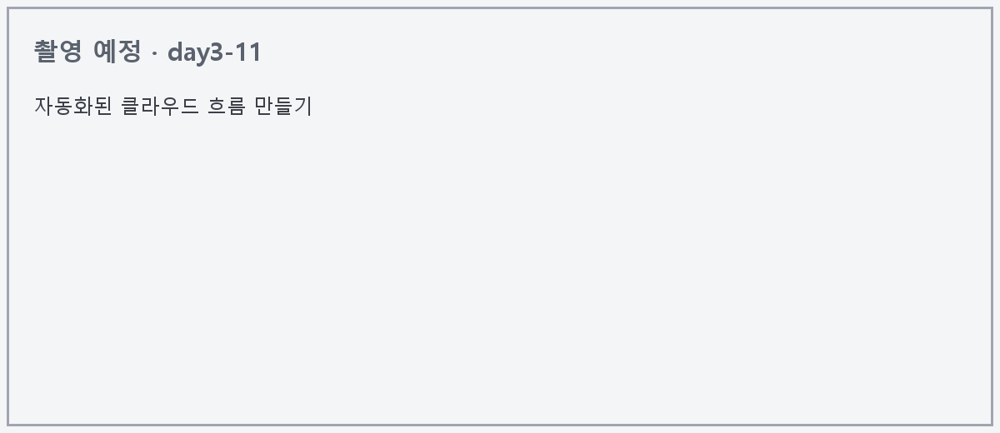

2. 트리거로 **항목이 만들어진 경우**(SharePoint)를 고르고 사이트와 `판매이슈요청_1회차_HGD` List를 지정합니다.

3. 동작 **승인 시작 및 대기**를 추가합니다. 검색 결과에 같은 이름이 두 개 나옵니다. **승인 형식** 칸이 있는 쪽을 고릅니다. 승인 형식은 **승인/거부 - 첫 번째로 응답**, 담당자는 내 계정으로 둡니다. 제목에 List의 제목과 금액을 넣습니다.

    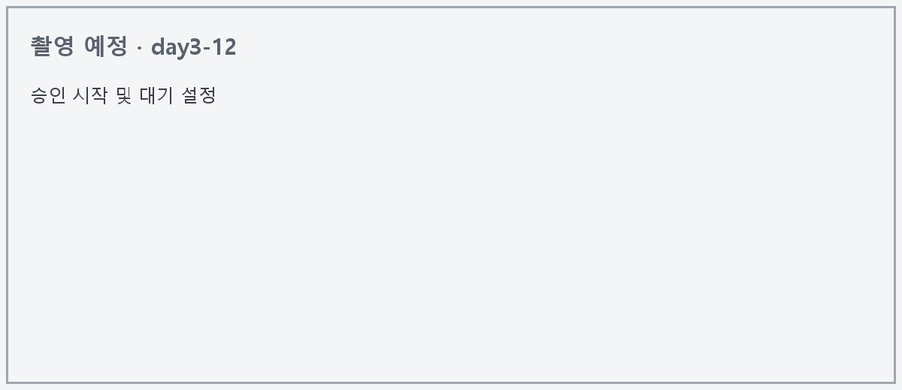

4. **컨트롤** → **조건**을 추가합니다. 왼쪽 값에 승인 동작의 **결과**, 오른쪽 값에 `Approve`를 넣습니다.

5. True·False 갈래에 SharePoint **항목 업데이트**를 하나씩 넣습니다. ID에는 트리거의 **ID**를 넣습니다. **고급 매개 변수**에서 **상태 Value**를 표시하고, True 갈래는 `승인`, False 갈래는 `반려`를 고릅니다.

    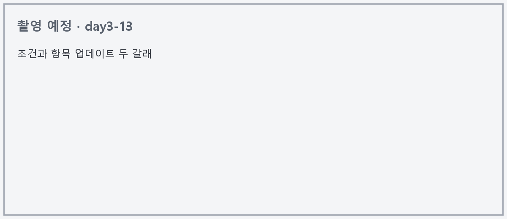

6. **초안 저장**을 누른 뒤 **게시**합니다. 게시하지 않은 흐름은 List에 행이 생겨도 실행되지 않습니다.

7. 5절 에이전트에서 요청을 하나 더 등록합니다.

8. Outlook에 온 승인 메일이나 Power Automate 왼쪽 메뉴 **승인** → **받음**에서 요청을 열고 **승인** → **확인**을 누릅니다.

    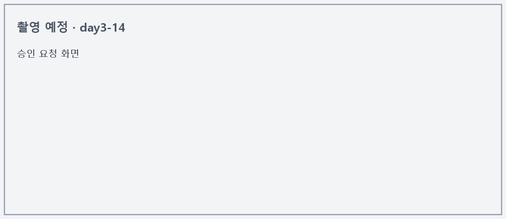

9. List에서 그 행의 상태가 `승인`으로 바뀌었는지 확인합니다.

10. 5절 에이전트에서 요청을 하나 더 등록하고, 이번에는 승인 요청에서 **거부** → **확인**을 누릅니다.

11. List에서 그 행의 상태가 `반려`로 바뀌었는지 확인합니다. 조건의 False 갈래가 이 행을 바꿉니다.

확인

- 에이전트 → 에이전트 흐름 → List 새 행 → 승인 흐름 → 사람의 승인 → List 상태 순서로 이어집니다.
- 승인 여부는 에이전트가 정하지 않고 사람이 정합니다.

---

## 7절. 내 업무의 구조 고르기 (0:20)

| 업무 요구사항 | 먼저 검토할 구조 |
|---|---|
| 지금 연 문서의 작성·분석·편집 | Office 앱의 Copilot |
| 일회성 분석, 여러 파일 대상 작업 | M365 Copilot Chat |
| 같은 방식과 형식으로 반복하는 작업 | Chat + 스킬 |
| 업무 지식과 역할을 여러 사람이 같이 씀 | Agent Builder |
| 규칙대로 기록하고 사람이 승인함 | Power Automate |
| AI 판단과 시스템 실행을 묶음 | Copilot Studio + 에이전트 흐름 |

위에서부터 차례로 봅니다. 요구사항을 채우는 가장 단순한 구조를 고릅니다.

1. 1절의 Chat 대화에 아래 문장을 보냅니다. 위 표가 문장 안에 들어 있습니다.

    ```
    위에서 나눈 내 업무를 아래 선택표 기준으로 보고, 맞는 구조를 고르세요. 처리·검증·판단·예외를 어디에 맡길지 정리해 주세요. 더 단순한 구조로 같은 일을 할 수 있는지도 적어 주세요. 표는 위에서부터 차례로 보고, 요구사항을 채우는 가장 단순한 구조를 고릅니다.

    [선택표]
    | 업무 요구사항 | 먼저 검토할 구조 |
    |---|---|
    | 지금 연 문서의 작성·분석·편집 | Office 앱의 Copilot |
    | 일회성 분석, 여러 파일 대상 작업 | M365 Copilot Chat |
    | 같은 방식과 형식으로 반복하는 작업 | Chat + 스킬 |
    | 업무 지식과 역할을 여러 사람이 같이 씀 | Agent Builder |
    | 규칙대로 기록하고 사람이 승인함 | Power Automate |
    | AI 판단과 시스템 실행을 묶음 | Copilot Studio + 에이전트 흐름 |
    ```

2. 답이 고른 구조가 내 판단과 같은지 확인합니다.

---

## 확인

- [ ] 내 업무를 입력·처리·판단·검증·출력·예외로 나눴다
- [ ] 열 형식을 정해 List를 만들었다
- [ ] 에이전트가 흐름으로 List에 요청을 등록했다
- [ ] 승인 흐름으로 사람이 승인·반려하고 List 상태가 각각 바뀌었다
- [ ] 내 업무에 맞는 가장 단순한 구조를 골랐다
